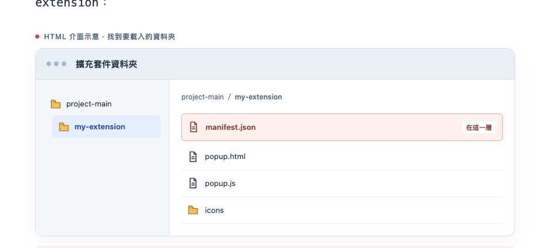

# Max行銷誌文章守則

新增、改寫、移植或更新文章時，先比對使用者的原稿、當次指示與站內已確認的同類文章。NetSuite 教學另依[系列製作規範](NETSUITE_GUIDE_RULES.md)，首圖依[文章封面規範](artwork/README.md)。

## 1. 讓讀者先知道這篇能解決什麼

- 開頭用繁體中文直接說明主題、適用對象，以及讀完能理解或完成的事。產品更新先交代功能改了什麼、誰需要處理，情境案例放到概念講清楚之後。GTM 新功能教學曾用假設有人下單開場，讀者要讀到後面才知道這次更新的重點。
- 解釋容易混淆的概念時，用同一組小資料示範操作前後，再進入完整案例。Data Studio 聯集篇可用兩張小表，對照 JOIN 如何依鍵配對，以及 UNION 如何把對應欄位的資料往下接，並展示各自的結果。
- 需要照著操作的步驟要寫出入口、按鈕名稱、適用條件和完成後的畫面。用官方文件與可取得的實際介面核對。只在特定版本或權限下需要的步驟，寫清楚何時才需要。文中只描述實際做過的測試。
- 依文章需要安排目錄、操作圖與 FAQ。FAQ 收錄讀者真的會卡住的問題，合併正文已解答的重複題目。刪除段落時同步更新目錄。Chrome 篇的五題 FAQ 和刪除操作路徑摘要，依該篇的編輯決定執行。

## 2. 圖要能幫讀者完成眼前的步驟

- 操作圖放在對應步驟旁，畫出讀者會看到的產品介面，標清入口、欄位或按鈕。使用者提供參考圖時，核對圖示、標籤與操作順序。HTML 重繪圖依下方規範製作並標明「介面示意」；實拍僅於當次需求允許時使用，須清楚且遮蔽私密資訊。核對畫面與當前步驟是否對得上。
- 頁面沿用既有 blog 版型，首圖沿用已確認的品牌樣式，內文圖解保留原稿已確認的配色與辨識度。NetSuite 曾把站色硬套到內文圖解後又重做。
- 首圖使用 1200 × 675 px，並同步文章、首頁卡片、分類與年度列表、社群分享預覽實際引用的圖片、尺寸與版本。只改首圖時，保留已確認的內文圖解和互動內容。

### HTML 介面示意圖風格

2026-11-21 使用者確認：HTML 介面示意圖沿用下方參考圖的視窗風格與配色，並以 [Chrome 擴充套件篇的示意圖樣式](docs/assets/css/posts/chrome-extension-import.css)作為結構參照。這是新增 HTML 示意圖，以及使用者指定統一風格時的預設；其他已確認的系列圖保留原樣，當次指示優先。

- 使用 HTML／CSS 製作介面，不以真實產品截圖替代。簡單圖示可用內嵌 SVG；商店、帳號與訂單等範例資料使用虛構內容，不把示意結果寫成實際測試紀錄。
- 視窗外框使用白底、1 px 淺藍灰邊線、約 14 px 圓角與輕微陰影。頂部為淺藍灰標題列，左側放三顆低彩度圓點及深藍灰標題。
- 視窗上方放小紅點與「HTML 介面示意 · 操作主題」標籤，圖下保留說明。使用無襯線字體，內容以 13–15 px 為主，說明文字約 12 px；區塊留白以 16、20、24 px 為基準。
- 選取狀態用淡藍底與藍字；要讀者注意的目標欄位、列或按鈕，以細珊瑚紅框、淡紅底及深紅字標示。紅色集中用於目標與步驟，不鋪滿整張圖。
- 不另套產品品牌的米色、黑色或深色標題列。不同產品的操作名稱、欄位與順序仍須正確，示意圖的外觀則使用同一套色盤。
- 手機版允許將側欄、雙欄與選單改為上下排列，但不能裁掉文字或產生整頁橫向捲動。完成後在桌機及 390／320 px 寬度驗收，並核對文章原有互動。

| 用途 | 色碼 |
| --- | --- |
| 內容背景 | `#ffffff` |
| 標題列 | `#eef2f7` |
| 側欄、次要區塊 | `#f7f9fb` |
| 外框／細分隔線 | `#dfe5ed`／`#e8eef5` |
| 主要文字／輔助文字 | `#253449`／`#637187` |
| 標題列三顆圓點 | `#b3bece` |
| 選取背景／選取文字 | `#eaf2ff`／`#174da5` |
| 主要按鈕、啟用開關 | `#2466d2` |
| 重點標記／淡紅背景 | `#d65050`／`#fff4f1` |
| 重點細框／重點文字 | `#efb1aa`／`#853b33` |

## 3. 把文末與連結做完整

- 文末都有「其他延伸閱讀」與可見的作者介紹。延伸閱讀使用相關且確實存在的站內文章。作者介紹使用 `components/article-author.html` 提供的共用版位，實際捲到文末確認看得到，尤其是在省略上一篇／下一篇時。
- 站外的 `http:`、`https:` 與 `//` 網頁連結使用 `target="_blank" rel="noopener noreferrer"`，原有的 `nofollow`、`sponsored` 等值一併保留。站內文章、頁內錨點、`mailto:` 和 `tel:` 維持原本的導覽行為。NetSuite 的首圖與內文圖片依系列規範，點擊後另開分頁顯示原圖。

## 4. 改文章時同步所有呈現位置

- 從 `docs/post/<slug>/index.html` 核對標題、摘要、封面、canonical 與文章結構化資料。變更標題、產品名稱或圖片時，核對適用的首頁、分類、標籤、年度列表、站內搜尋、RSS 與社群分享資訊。全站改名還要檢查圖檔內的文字。既有文章網址與轉址依當次需求處理。
- 正文、標題或首圖有實際改動時，保留原本的 `article:published_time`，更新 `article:modified_time` 和 JSON-LD 的 `dateModified`。建置後核對文章顯示的「最後更新時間」、sitemap 的 `lastmod` 與使用更新時間的列表。範本重建或快取參數變動本身沿用原更新時間。Data Studio 改名與更換首圖曾漏改日期，頁面仍顯示舊的最後更新時間。
- 新增或改寫文章時沿用既有共用元件與系列入口。資料與互動完整移植時，逐一核對原本的地圖、展開、分頁或其他讀者會用到的功能。文章工作若涉及首頁或作者頁改版，依當次指定的範圍處理。

## 5. 先驗收畫面，再交付或發布

- 文章完成後依序執行 `npm run finalize` 和 `npm run validate`。檢查建置輸出中的連結、錨點、作者版位及衍生頁面。有篇數或圖片數差異時，先核對實際新增的文章與資源。
- 在桌機和窄螢幕手機以瀏覽器從首圖看到頁尾，確認段落、圖解和互動元件沒有溢位、裁切或多餘空白。實際點擊目錄、FAQ、圖片放大與該篇互動。咖啡地圖曾在靜態檢查通過後，仍出現手機白邊、桌機地圖留白和排名偏移。
- 使用者要看整頁時，交付從頁首到頁尾的實際截圖，文字太小時加上分段圖。使用可在手機對話直接查看的圖片或附件。工具裡能看到圖片、檔案存在本機或送出 `localhost` 連結，都不足以確認使用者收得到。顯示狀態未確認時，如實說明。
- 既有圖片、CSS 或 JS 更新後，檢查實際引用的資源版本。收到發布指示後再發布，並等部署完成後打開正式頁面，確認新資源、日期、版面及相關功能已生效。咖啡地圖和多篇封面都曾因舊快取在正式站繼續顯示舊版。

## 返工案例與依據

| 文章或變更 | 曾發生的問題 | 可核對紀錄 |
| --- | --- | --- |
| Chrome 擴充套件匯入 | 文末缺延伸閱讀與作者介紹，外部連結另開規格需補齊，FAQ 曾多達 11 題後縮成 5 題。 | 2026-11-03 專案對話、`34e6c961` |
| NetSuite 前兩篇與封面調整 | 內文圖解被硬套站色，兩篇圖片的放大行為需統一，多篇封面部署後仍讀到舊圖。 | 2026-10-15 專案對話、`6bf410f7`、`442d876c`、`7dfd961e` |
| GTM 新功能 | 開頭先講假設訂單，操作圖缺少對應的 GTM 介面，手機端未收到可直接看的完整預覽。 | 2026-11-07 至 11-08 專案對話 |
| Data Studio 聯集與改名 | JOIN／UNION 說明難懂，圖示和參考畫面不同，舊產品名留在部分首圖，實質更新後漏改日期。 | 2026-11-07 至 11-09 專案對話、`e6129354`、`5ae6e607` |
| 曼谷與宮古島咖啡地圖 | 手機寬度、桌機留白與排名對齊需返工，資源快取讓正式站仍讀到舊版。 | 2026-08-04 專案對話、`7b523e01`、`ebbf2e41`、`c227d894`、`7d8dc988` |
